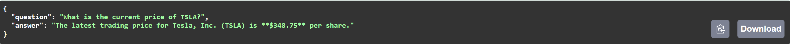
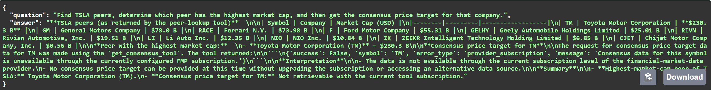
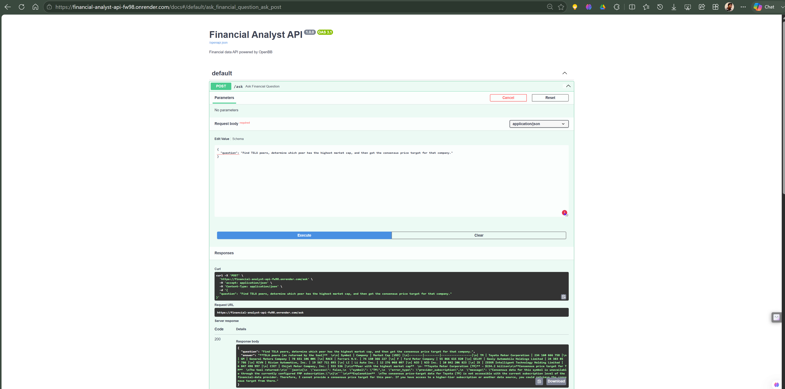

# Agentic Financial Research Assistant

An agentic AI application that performs multi-step financial research using
LLM-driven tool selection and financial data tools.

Built with **FastAPI, LangChain, OpenBB, and configurable LLM providers**,
the agent can decide which financial tools to use, execute multiple tool
calls sequentially, and synthesize the results into a final answer.

## Live Demo

🖥️ **Live web interface:** https://financial-research-assistant-web.vercel.app

📁 **Web interface source:** [`web/`](web/README.md) — Vite + React + Tailwind,
themed to match the portfolio.

🔗 **Live assistant:** https://financial-analyst-api-fw98.onrender.com

💻 **Project folder:** https://github.com/JatinKumarSharma/Agentic_AI_Projects/tree/main/financial-research-assistant

## Deployment

The assistant is deployed as a cloud web service on Render. It is an agentic AI
system compatible with Groq, OpenAI, Google Gemini and Ollama models — not a
single fixed model or a thin data endpoint.

Browser access is restricted through the `FRONTEND_ORIGINS` environment
variable (comma-separated). Localhost `5173` is allowed by default.

The deployment uses environment variables for configuration and keeps
sensitive provider credentials outside the source code.

Example environment configuration:

```env
LLM_PROVIDER=groq
GROQ_MODEL=openai/gpt-oss-20b
GROQ_API_KEY=your_api_key

FMP_API_KEY=your_api_key

# Optional evidence sources
FRED_API_KEY=your_fred_api_key
TAVILY_API_KEY=your_tavily_api_key
BRAVE_API_KEY=your_brave_api_key
SERPER_API_KEY=your_serper_api_key
SEC_USER_AGENT=FinancialResearchAssistant/1.2 (research prototype; contact@example.com)
```

`SEC_USER_AGENT` should contain real contact information in a deployed
environment. Web search supports Tavily, Brave, and Serper. Leave
`WEB_SEARCH_PROVIDER` unset to auto-detect from the keys present; if one
provider errors or returns no allowlisted results, the adapter falls back to
the next configured provider in the order Tavily → Brave → Serper. Results are
still filtered against a strict domain allowlist.

## What Makes It Agentic?

Unlike a traditional API endpoint that executes a predefined sequence of
operations, this system uses an LLM-driven agent loop.

The agent can:

- Decide whether external financial data is required.
- Select the appropriate financial tool.
- Execute one or more tools dynamically.
- Use previous tool results to determine the next action.
- Continue the workflow until enough information is available.
- Return a final answer grounded in retrieved data.

### Current capabilities and boundaries

The agent can retrieve quotes, profiles, peers, aggregate performance, analyst
consensus, company news, and **daily historical OHLC prices** for supported
symbols. Historical-price questions use `get_historical_prices_tool`, which
returns a compact table and an explicit `period_change_pct`.

It can also pull evidence from additional source tiers:

| Tier | Tool | Source |
|---|---|---|
| Primary filings | `get_sec_filings_tool` | SEC EDGAR filing index and document URLs |
| Primary XBRL facts | `get_sec_company_facts_tool` | SEC company facts (`us-gaap`) |
| Structured statements | `get_financial_statement_tool` | OpenBB / FMP income, balance-sheet and cash-flow rows |
| Macro indicators | `get_macro_indicator_tool` | FRED series such as GDP, CPI, unemployment and Treasury yields |
| Discovery | `search_financial_web_tool` | Allowlisted public finance domains only |

Each adapter returns `success`, `source`, `source_url`, `retrieved_at`, and a
stable `error_type`. Web results are explicitly marked as discovery leads so
the final guardrail either attributes them by domain/URL or adds a source note.

Tool selection is **minimum-sufficient**: a deterministic plan derived from the
question sets a call ceiling, and the system prompt requires the model to stop
as soon as the question is answered. The ceiling is not a hard router — the
model still chooses the exact tools — but it prevents exploratory loops that
consume time and tokens without adding evidence.

It cannot generate images and has no access to previous conversations.
Capability, scope, source and tool-loop boundaries are enforced by
deterministic guardrails in [`guardrails.py`](guardrails.py), not by prompt
instructions alone. If a source is unconfigured or restricts a symbol, the
agent reports the limitation instead of inventing a chart or substituting
internal knowledge.

### Example Multi-Step Query

> Find TSLA peers, determine which peer has the highest market cap, and
> then get the consensus price target for that company.

To answer this, the agent may perform the following workflow:

```text
User Question
      |
      v
LLM analyzes the task
      |
      v
Get TSLA peers
      |
      v
Analyze peer market capitalizations
      |
      v
Identify the largest peer
      |
      v
Retrieve consensus price target
      |
      v
Generate final answer
```

## Architecture

```text
                          USER
                           |
                           v
                    +-------------+
                    |   FastAPI   |
                    | POST /ask   |
                    +------+------+
                           |
                           v
                +---------------------+
                |   Agent Execution   |
                |        Loop         |
                +----------+----------+
                           |
                           v
                +---------------------+
                |       LLM Layer     |
                |---------------------|
                | Groq                |
                | Google Gemini       |
                | Local Ollama        |
                +----------+----------+
                           |
                     Tool Calls?
                    /           \
                  Yes            No
                   |              |
                   v              v
        +------------------+  Final Answer
        | Financial + Evidence Tools |
        +--------+---------+
                 |
                 v
             OpenBB
                 |
                 v
      Financial Data Providers
                 |
                 v
            Tool Results
                 |
                 +--------------------+
                                      |
                                      v
                              Back to Agent Loop
```

## Supported LLM Providers

The agent uses a configuration-driven provider abstraction that allows the
underlying LLM to be switched without changing the agent execution logic.

| Provider | Example Model | Deployment Mode |
|---|---|---|
| Groq | `openai/gpt-oss-20b` | Cloud |
| Google Gemini | `gemini-2.5-flash` | Cloud |
| Ollama | `llama3.2:3b` | Local |

Select the active provider through environment configuration:

```env
LLM_PROVIDER=groq
```

## Tech Stack

  | Component       | Technology                  |
| --------------- | --------------------------- |
| Language        | Python                      |
| API Framework   | FastAPI                     |
| Agent Framework | LangChain                   |
| LLM Providers   | Groq, Google Gemini, Ollama |
| Evidence Sources | OpenBB, SEC EDGAR, FRED, allowlisted web |
| Data Processing | Pandas                      |
| Validation      | Pydantic                    |
| API Server      | Uvicorn                     |
| Deployment      | Render                      |

## Project Structure

```text
Agentic_AI_Projects/
├── financial-research-assistant/       ← this project
│   ├── assets/
│   │   ├── deployed-api.png
│   │   ├── multi-step-query.png
│   │   └── simple-query.png
│   ├── eval-runs/                      ← evaluation evidence
│   │   ├── EVAL_LOG.md
│   │   ├── eval_suite.py
│   │   ├── eval_suite_v0.json … v5.json
│   │   ├── guardrails_test.py
│   │   ├── source_tools_test.py
│   │   ├── v6_source_suite.py
│   │   ├── live_v6_trace_suite.py
│   │   └── agent_baseline.py
│   ├── .env.example
│   ├── agent.py
│   ├── financial_tools.py
│   ├── guardrails.py                   ← deterministic checks
│   ├── source_tools.py                 ← SEC, FRED, statements, web adapters
│   ├── main.py
│   ├── README.md
│   └── requirements.txt
└── adaptive-customer-voice-interviewer/
    └── README.md                       ← reserved space
```

> **Deployment note:** the repository root contains thin `main.py` and
> `requirements.txt` shims that load this project, so Render can keep building
> from the repo root with `uvicorn main:app`. No Root Directory change is
> needed. All application logic stays in this folder.

### `main.py`

Defines the FastAPI application and exposes the HTTP API endpoints.

### `agent.py`

Contains the tool-enabled LLM agent, tool wrappers, system instructions,
and the multi-step tool execution loop.

### `financial_tools.py`

Contains functions that retrieve financial information through OpenBB.

### `requirements.txt`

Contains the Python dependencies required to run the project.

## API Endpoints

  Method   Endpoint                        Purpose
  -------- ------------------------------- ------------------------------------------
  POST     `/ask`                          Ask a financial question using the agent
                                           (`include_trace: true` adds tool evidence)
  GET      `/`                             API health/home endpoint
  GET      `/health`                       Health check
  GET      `/version`                      Commit, model and source configuration
  GET      `/sources`                      Configured evidence sources, no secrets
  GET      `/stock/search/{symbol}`        Search for a stock
  GET      `/stock/{symbol}/profile`       Retrieve company profile
  GET      `/stock/{symbol}/peers`         Retrieve peer companies
  GET      `/stock/{symbol}/quote`         Retrieve latest quote
  GET      `/stock/{symbol}/performance`   Retrieve price performance
  GET      `/stock/{symbol}/consensus`     Retrieve analyst consensus
  GET      `/news/{symbol}`                Retrieve company news

## Example Request

### Ask a Financial Question

`POST /ask`

``` json
{
  "question": "What is the current price of TSLA?"
}
```

Example response:

``` json
{
  "question": "What is the current price of TSLA?",
  "answer": "The current price of TSLA (Tesla, Inc.) is $362.86 as of the last trade on August 21, 2026."
}
```

## Agent Capabilities

The agent currently has access to tools for:

-   Stock search
-   Company profiles
-   Peer companies
-   Stock quotes
-   Price performance
-   Analyst consensus
-   Company news
-   Daily historical OHLC prices
-   SEC filing index and XBRL company facts
-   Income, balance-sheet and cash-flow statements
-   FRED macro indicators
-   Allowlisted public web search

It can perform multiple tool calls when a question requires several
pieces of information.

Example workflow:

``` text
Find TSLA peers
      ↓
Compare market capitalizations
      ↓
Identify highest-market-cap peer
      ↓
Request consensus price target
      ↓
Return result or explain provider limitation
```

## Example Questions

``` text
What is the current price of TSLA?

Show me the profile of Tesla.

What are TSLA's peers?

How has TSLA performed over the last year?

What is the analyst consensus price target for TSLA?

Find TSLA peers, determine which peer has the highest market cap,
and then get the consensus price target for that company.

Show me Apple's most recent 10-K filings from SEC EDGAR.

What is Microsoft's latest annual revenue from SEC XBRL company facts?

Pull Tesla's annual cash-flow statement for the last four periods.

What is the latest US CPI reading from FRED?

Find recent Reuters or Bloomberg coverage about Nvidia before its earnings.
```

## Example Agent Workflows

### Simple Financial Query

The agent can answer financial questions by selecting the appropriate
financial-data tool and grounding its response in retrieved data.



### Multi-Step Agentic Research

For complex queries, the agent can perform dependent tool calls where the
result of one step informs the next action.

Example:

> Find TSLA peers, determine which peer has the highest market cap, and
> then get the consensus price target for that company.



### Deployed API

The application is deployed as a cloud service and exposes the agent
through a REST API.



## Running Locally
### 1. Clone the repository

``` bash
git clone https://github.com/JatinKumarSharma/Agentic_AI_Projects.git
cd Agentic_AI_Projects/financial-research-assistant
```
### 2. Create a virtual environment

Windows:

``` bash
python -m venv .venv
.venv\Scripts\activate
```
macOS/Linux:
```bash
python -m venv .venv
source .venv/bin/activate
```
### 3. Install dependencies

``` bash
pip install -r requirements.txt
```
### 4. Configure environment variables

Create a `.env` file based on .env.example.
Example using Groq:

```env
LLM_PROVIDER=groq

GROQ_API_KEY=your_api_key
GROQ_MODEL=openai/gpt-oss-20b

FMP_API_KEY=your_api_key
FRED_API_KEY=your_fred_api_key
TAVILY_API_KEY=your_tavily_api_key
SEC_USER_AGENT=FinancialResearchAssistant/1.2 (research prototype; contact@example.com)
```
### 5. Start the application

``` bash
uvicorn main:app --reload
```

Open:

``` text
http://127.0.0.1:8000/docs
```

The interactive Swagger documentation can be used to test all available endpoints.

### Provider abstraction

Our agent code doesn't fundamentally change when switching:

```text
Groq
  │
Google Gemini ───> Same Agent Loop ───> Same Tools
  │
Ollama
```

## Design Principles

The agent is instructed to:

1.  Use financial tools whenever the question requires financial data.
2.  Never invent financial data.
3.  Prefer retrieved tool data over internal model knowledge.
4.  Use actual tool results when comparing companies.
5.  Clearly explain when requested data cannot be retrieved.
6.  Distinguish retrieved facts from reasoning.
7.  Perform multiple tool calls when required.
8.  Complete multi-step questions before producing the final answer.
9.  Avoid fabricating analyst names, ratings, dates, or price targets.
10. Explain provider errors using the information returned by the tool.
11. Do not fabricate analyst names, ratings, dates, or price targets.
12. Use a tool-supplied percentage field as returned — never recompute it
    from other fields.
13. Try an alternative tool after an empty search before concluding that
    data is unavailable.
14. Explain an ethical or privacy refusal in one sentence and offer a
    data-grounded alternative.
15. Use the historical-price tool for price movement and report its
    `period_change_pct` directly.
16. If no tool can answer, say so and list what you can provide.
17. Stay in the financial research role; no images and no prior-chat memory.
18. Do not repeat a failed ticker search; try the likely symbol once.
19. Use the smallest tool set that can fully answer the question; stop as soon
    as the evidence is sufficient.
20. Prefer SEC filings/facts, statements, and FRED over web snippets when the
    question needs primary or structured evidence.
21. Treat web results as discovery leads and attribute them by domain or URL.
22. Name sources when several are used and report disagreements.
23. Do not call overlapping tools for the same fact unless both are needed.
24. Report unconfigured sources honestly; never substitute internal knowledge.
25. Respect the deterministic tool-call ceiling supplied with the question.

## Evaluation

This project is scored with the **5-D Evaluation Framework** — Hallucination,
Factuality, Originality, Helpfulness and Harmlessness, scored independently
on a 1–5 scale with no aggregate.

A fixed five-question suite was run across four prompt iterations plus two
architectural/guardrail iterations. The first run exposed a real error: the
quote tool returned `change_percent: -0.019043` (−1.9043%) but the agent
answered **−0.62%**. A targeted rule fixed it, two later prompt interventions
produced no gain, one produced a regression and was reverted.

v4 added deterministic guardrails in [`guardrails.py`](guardrails.py): the
provider's fractional percentage is normalized in code, a mismatched percentage
is corrected, and a bare refusal is upgraded with a reason and a data-grounded
alternative. The refusal behaviour changed for the first time, but a new
unguarded claim regressed Factuality — that trade-off is recorded rather than
hidden.

v5 added capability/scope boundaries, normalized tool failures, historical
prices, a no-progress loop breaker and an honest iteration fallback. A live
"maximum number of tool iterations" failure became a bounded answer, and the
fixed suite recovered to Factuality 5.00. Full traces, scores and the change
log are in [`eval-runs/EVAL_LOG.md`](eval-runs/EVAL_LOG.md).

v6 is the source-expansion iteration. It adds SEC EDGAR, SEC XBRL facts,
structured statements, FRED macro indicators and allowlisted web search, plus
a deterministic minimum-sufficient tool-call ceiling and a web-source
attribution guardrail. The five-question suite stays unchanged for historical
comparability; v6 evidence is captured separately by `v6_source_suite.py`,
`live_v6_trace_suite.py`, `source_tools_test.py` and the extended
`guardrails_test.py`.

Reproduce any iteration from this folder:

```bash
pip install -r requirements.txt
python eval-runs/eval_suite.py v0        # or v1, v2, v3, v4, v5
python eval-runs/capability_probe.py    # v5 capability/scope/loop probes
python eval-runs/guardrails_test.py     # deterministic guardrail checks, no API calls
python eval-runs/source_tools_test.py   # adapter normalization, no API calls
python eval-runs/v6_source_suite.py     # v6 source/efficiency probe, real calls
python eval-runs/live_v6_trace_suite.py # deployed v6 traces, no local keys needed
```

> The fixed suite and local `v6_source_suite.py` require valid `GROQ_API_KEY`,
> `FMP_API_KEY`, `FRED_API_KEY` and one web-search key in a `.env` file. They
> make real provider calls and write trace JSON into this folder.
> `live_v6_trace_suite.py` calls a deployed API with `include_trace: true` and
> uses the service's own environment, so no local keys are needed. The
> guardrail and source-adapter tests are fully offline.

## Error Handling

The project includes basic handling for tool and provider failures.

For example, during testing, a consensus request can be unavailable
because of a provider subscription restriction. In that situation, the
agent reports the limitation instead of fabricating a result.

``` text
Tool succeeds
     ↓
Use retrieved data

Tool fails / provider restriction
     ↓
Historical prices: use a no-key public chart fallback
     ↓
Other endpoints: explain limitation
     ↓
Do not fabricate data
```

Historical prices can fall back to a public Yahoo Finance chart endpoint. It
requires no API key, account, or paid subscription, and is called inside the
existing price tool so the agent's tool-call budget does not change.

## Current Limitations

This project is an MVP and has several known limitations:

- Financial-data availability depends on the configured OpenBB data providers.
- Historical prices have a no-key public fallback; other endpoints still require
  their configured provider and may be restricted by its plan.
- LLM availability and rate limits depend on the configured provider and API quota.
- Company-news retrieval may return limited or empty results depending on provider availability.
- Local Ollama inference performance depends on the available hardware.
- The agent currently uses a bounded tool-execution loop and does not include advanced planning or persistent state management.
- Persistent conversation memory and portfolio management are not currently implemented.
- The project focuses on financial research and data retrieval rather than personalized investment advice.

## Project Status

**Deployed MVP — Functional**

The project currently supports:

- Cloud deployment on Render
- Tool-calling LLM agent
- Multi-step reasoning workflows
- Dynamic tool selection
- Multiple LLM providers
- Groq inference
- Google Gemini support
- Local Ollama support
- OpenBB financial data integration
- Provider-aware error handling
- Environment-based configuration
- REST API interface

### Tested Workflows

The following workflows have been successfully tested:

- Single-step financial queries
- Multi-tool financial research queries
- Sequential tool execution
- Peer comparison using market capitalization
- Provider switching through environment configuration
- Graceful handling of unavailable provider data
- Deployed API requests through the Render service

## Disclaimer

This project is intended for educational, research, and
software-engineering demonstration purposes. It does not provide
personalized investment advice and does not guarantee the accuracy,
completeness, or timeliness of financial data.

## Author

**Jatin Sharma**

Built as part of an ongoing portfolio of agentic AI and financial-data
projects.
